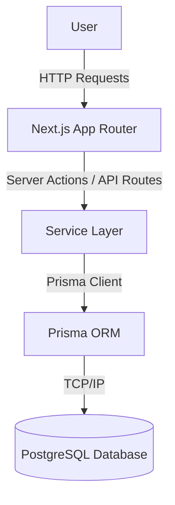

# Architecture Document

## 1. Project Overview
KAI Aura is a full-stack web application designed to manage tasks, collaborate in teams, and track an "Aura" (points ledger) reward system.

## 2. System Goals
- Deliver a robust, reliable, and secure platform.
- Ensure strict data integrity for the points ledger.
- Provide a smooth and responsive user interface.
- Maintain deterministic boundaries around AI capabilities.

## 3. High-Level Architecture


## 4. Application Flow
Requests enter via Next.js App Router, are handled by Server Actions or API Handlers, validated, processed by the business logic (Service Layer), and persisted via Prisma ORM to PostgreSQL.

## 5. Frontend Architecture
- **Framework:** Next.js (App Router)
- **UI Library:** React 19
- **Styling:** Tailwind CSS + shadcn-style components
- **Icons:** Lucide

## 6. Backend Architecture
- **Framework:** Next.js Server Actions / API Routes
- **Runtime:** Node.js v22.18
- **Service Layer:** Modular business logic separating UI from database operations.

## 7. Database Architecture
- **Database:** PostgreSQL (Native Windows local setup for dev)
- **ORM:** Prisma 7.10.0 (using `@prisma/adapter-pg` and `pg`)

## 8. Authentication/Authorization Architecture
The application uses session-based JWT authentication via Next.js Edge Middleware and server-side RBAC validation.
Role Hierarchy:
- SUPERADMIN ⊇ ADMIN
  - SUPERADMIN inherits all ADMIN capabilities.
  - SUPERADMIN-only capabilities: Awarding Aura, Settings.
- ADMIN (Existing Admin features: Task management, Analytics, Audit)
- MEMBER (Existing Member features: Dashboards, Submitting Tasks, Redeeming Store items)

## 9. AI Architecture
*(Proposed)* - Integration with AI for text generation or recommendations, operating strictly behind application boundary logic. AI will not handle authorization or ledger math.

## 10. External Services
*(Planned)* - Integrations to be defined.

### Notification Delivery Architecture
    Domain Service
          ↓
    NotificationService
          ↓
    Notification
          ↓
    NotificationDelivery
          ↓
       PENDING
          ↓
    Delivery Processor
          ↓
    EmailService
          ↓
    Nodemailer
          ↓
    SMTP Provider

NotificationDelivery's unique notification/channel constraint guarantees that only one delivery record exists for a notification/channel pair. It does not provide exactly-once external email transmission.

## 11. Data Flow
Data mutations must pass through strict validation before reaching the Service Layer and Database.

## 12. Request/Response Flow
Client -> Middleware (Auth) -> Server Action -> Validation -> Service -> Repository -> Database.

## 13. Folder/Module Responsibilities
- `src/app`: Next.js App Router pages and layouts.
- `src/components`: Reusable UI components.
- `src/lib`: Shared utilities.
- `prisma/`: Database schema and migrations.

## 14. Major Architectural Boundaries
- UI components must not contain business logic.
- AI must not dictate application state deterministically.
- Database access only via the Service/Repository layer.

## 15. Technology Stack
- Next.js
- React
- TypeScript
- Tailwind CSS
- Prisma 7
- PostgreSQL

## 16. Environment Architecture
- Local: Native Node.js and PostgreSQL.
- Staging/Production: To be determined.

## 17. Development vs Production Architecture
Currently focusing on local development baseline.

## 18. Architectural Decisions
- Removed legacy `next.js` dependency.
- Pinned Prisma to `7.10.0`.
- Pivoted from Docker to Native Windows PostgreSQL for local dev.

## 19. Future Extension Points
- Background workers for notifications.
- Admin analytics dashboard.

---

## Status Classification

### IMPLEMENTED
- Next.js application baseline
- PostgreSQL local environment
- Prisma 7 dependency (pinned to 7.10.0)
- PostgreSQL adapters (`@prisma/adapter-pg`, `pg`)
- Environment files scaffolded (`.env`, `.env.example`)
- Database connection initialization
- Complete Database Schema (Identity, Tasks, Gamification, Aura Ledger, Teams, Store, Platform Services)

### PLANNED
- Application Architecture & Service Layers (Phase 02 - In Progress)
- Authentication & Authorization
- Application Logic for Domain Models (Tasks, Aura Ledger, Teams, Store)

### PROPOSED
- AI orchestration layer
- Background workers
- Analytics / Admin

## 20. Notification Architecture (SMTP-05)
- **Central Dispatcher**: All user-facing notification events route exclusively through `NotificationService.dispatch()` to enforce consistency for delivery tracking, preferences, and template evaluations. Domain services must not invoke `prisma.notification.create` directly.
- **Preference Evaluation**: Before dispatching, the system evaluates `NotificationPreference` configurations. If `inAppEnabled` is false, the canonical `Notification` is created but visually suppressed (pre-read). If `emailEnabled` is false, the `NotificationDelivery` record is entirely bypassed.
- **Delivery Generation**: The dispatcher creates a `NotificationDelivery` (PENDING status) if the corresponding email channel is enabled.
- **Delivery Processor**: DeliveryProcessorService securely polls for PENDING and stale deliveries utilizing database atomic row-level locks, shielding against cross-instance concurrent anomalies.
- **Template Resolution**: TemplateResolver dynamically translates notification payloads into robust HTML-escaped layouts with strict fallback protections against XSS from user-controlled metadata.
- **Transport**: `EmailService` is exclusively restricted to SMTP transmission over `nodemailer` and manages terminal delivery states (SENT, FAILED).

### SMTP Delivery Worker
NotificationDelivery records are asynchronously consumed by a dedicated delivery worker (`src/worker.ts`).
The worker:
1. Orchestrates continuous bounded polling at configured intervals (`DELIVERY_WORKER_INTERVAL_MS`).
2. Discovers PENDING deliveries and cleanly delegates atomic claiming to `EmailService`.
3. Distinguishes transient failures (4xx, connection timeouts) from permanent failures (5xx, template invalidations).
4. Recovers stale PROCESSING deliveries older than 10 minutes safely back into the PENDING queue.
5. Applies process-controlled exponential backoff for transient retries, capping at `DELIVERY_WORKER_MAX_RETRIES`.
6. Executes graceful shutdown intercepts on SIGINT/SIGTERM to prevent orphaned delivery states and safely disconnect Prisma.

*Note on Crash Consistency*: The system uses best-effort / at-least-once delivery semantics and does not guarantee exactly-once external email transmission. A crash directly following SMTP provider acceptance, but prior to durable SENT persistence, may manifest a duplicate transmission on subsequent worker recovery sweeps.

## 21. Notification Observability & Admin Dashboard (SMTP-08)

```
Notification Delivery Observability
        ↓
Observability Service (`NotificationObservabilityService`)
        ↓
Server-Side Authorization Boundary (`assertAdminAuthorization`)
        ↓
Prisma Aggregation / Query Layer (`count`, `groupBy`, paginated `findMany`)
        ↓
Admin / Superadmin Dashboard (`EmailDeliveriesDashboard` & `DeliveryDetailModal`)
```

### 1. Authorization Boundary
- **Role Hierarchy**: Strictly enforced at the server action layer (`src/actions/observability.actions.ts`) using `assertAdminAuthorization()`.
- **Permitted Roles**: `SUPERADMIN` and `ADMIN`.
- **Denied Roles**: `MEMBER` (receives explicit `403 Administrative authorization required` `AuthorizationError` on direct server action invocation).
- **UX Gating**: Dashboard navigation links and route tabs are conditionally rendered only for authorized administrative sessions.

### 2. Aggregation & Metrics Strategy
- **Parallel Query Execution**: `getDeliverySummary()` executes independent aggregation queries in parallel using `Promise.all`:
  - Total deliveries (`count`)
  - Status breakdown (`groupBy` on `status`)
  - Notification type breakdown (`groupBy` on `notificationId` joining canonical notifications)
  - Queue activity telemetry: determines recent activity timestamps (`lastProcessedAt`, `lastSentAt`, `lastFailedAt`, `staleProcessingCount`).
- **Performance**: Direct database-level aggregations ensure zero full-table fetches into application memory.

### 3. Pagination & Query Bounds
- **Deterministic Pagination**: Skip/take pagination using validated numeric query parameters.
- **Enforced Safety Bounds**:
  - `DEFAULT_PAGE_SIZE = 20`
  - `MAX_PAGE_SIZE = 100` (prevents unbounded memory consumption or denial-of-service queries).

### 4. Server-Side Filtering
- **Supported Parameters**:
  - `status`: Filter by `DeliveryStatus` enum (`PENDING`, `PROCESSING`, `SENT`, `FAILED`).
  - `type`: Filter by `NotificationType` on related notification records.
  - `startDate` / `endDate`: Bounded `createdAt` temporal filtering.
  - `search`: Case-insensitive text search querying recipient email, recipient name, or notification title.
- **Injection Safety**: Parameterized queries using Prisma's native relational filter syntax.

### 5. Sensitive Data Sanitization
- **Credential & Secret Redaction**:
  - `sanitizeErrorDetails`: Strips SMTP passwords, database connection strings, auth tokens, bearer credentials, and host file paths from `errorDetails`.
  - `sanitizeMetadata`: Recursively parses notification metadata objects to mask sensitive keys (`password`, `secret`, `token`, `cookie`, `jwt`) with `[REDACTED]`.
- **Read-Only Detail Modal**: Inspects delivery payload, execution timestamps, sanitized failure reasons, and recipient details without exposing raw database connection parameters or SMTP environment secrets.

### 6. Worker Health Observability & Inferred Telemetry
- **Truthful Telemetry**: The system avoids fabricating a synthetic "worker online" status.
- **Inferred Activity Indicators**: Health is inferred from recent activity timestamps (`lastProcessedAt`, `lastSentAt`, `lastFailedAt`) and the presence of stale `PROCESSING` records (`updatedAt < 10 minutes ago`).
- **Documented Limitation**: A durable process heartbeat mechanism remains a candidate for future architectural infrastructure enhancements.

## 22. Production Queue & Distributed Worker Infrastructure (SMTP-09)

### 1. System Topology & Architectural Boundaries
The notification delivery architecture transitions from single-process database polling to a hybrid, resilient distributed queue architecture powered by BullMQ and Redis, with PostgreSQL remaining the authoritative delivery ledger.

```
Domain Event (Task, Aura, Kudos, Store)
      ↓
NotificationService.dispatch()
      ↓
[PostgreSQL Transaction: Notification + NotificationDelivery (PENDING)]
      ↓ (Commit)
NotificationQueueProducer.enqueueDelivery(deliveryId)
      ↓
BullMQ Queue ("aura-email-deliveries" on Redis)
      ↓ (Deterministic Job ID: delivery-{id})
Distributed NotificationWorker(s) (Concurrency: configurable)
      ↓
EmailService.processDelivery(deliveryId)
      ↓ (Atomic claiming: PENDING/stale -> PROCESSING)
Nodemailer SMTP Transport
      ↓
SMTP Provider
      ↓
[PostgreSQL Update: SENT / FAILED]
      ↓
NotificationObservabilityService (Admin Dashboard)
```

### 2. Separation of Concerns & Boundary Responsibilities
- **PostgreSQL (Authoritative Delivery Ledger)**:
  - Source of truth for all business entities (`User`, `Notification`, `NotificationPreference`, `NotificationDelivery`).
  - Authoritative record of delivery state (`PENDING`, `PROCESSING`, `SENT`, `FAILED`), delivery attempts count, timestamps (`createdAt`, `updatedAt`, `sentAt`), and error details.
  - Audit trail and historical queryability.
- **Redis (Transient Transport & Job State)**:
  - High-throughput, distributed FIFO message transport and queue buffering.
  - Tracks transient job state (`waiting`, `active`, `completed`, `failed`, `delayed`).
  - Retains worker heartbeat leases (`worker:heartbeat:{workerId}`) with TTL.
  - Never stores raw business records or PII payloads.
- **BullMQ (Job Orchestration Engine)**:
  - Manages worker pool concurrency, lock renewal (`stalledInterval`), and delayed exponential backoff scheduling.
  - Enforces deterministic job deduplication (`jobId: delivery-${deliveryId}`).
  - Bounded job retention (`removeOnComplete: 1000`, `removeOnFail: 500`) preventing unbounded Redis memory growth.
- **EmailService & DeliveryProcessorService (Transport Boundary)**:
  - Manages atomic claiming query (`status: PENDING` or stale `PROCESSING` -> `PROCESSING`).
  - Resolves email templates, sanitizes dynamic HTML, and invokes Nodemailer transport.
  - Classifies errors into transient vs. permanent.
- **NotificationWorker (Execution Boundary)**:
  - Connects to BullMQ queue, consumes delivery jobs, coordinates with `EmailService`.
  - Emits periodic worker heartbeats to Redis every 10s with 30s TTL.
  - Graceful shutdown intercepting `SIGINT`/`SIGTERM`, awaiting in-flight jobs.
- **ObservabilityService (Operational Visibility)**:
  - Surfaces real-time queue depth (`waiting`, `active`, `completed`, `failed`, `delayed`), Redis connectivity status, registered worker heartbeats, and administrative retry actions.

### 3. Idempotency & Delivery Guarantees
- **At-Least-Once Delivery**: External SMTP does not support two-phase distributed transactions. If the SMTP provider transmits an email but the worker process terminates or crashes prior to updating the database state, the delivery may be retried. The architecture explicitly designs for at-least-once delivery semantics.
- **Multi-Layer Idempotency**:
  1. *Database Layer*: Unique constraints (`notificationId_channel`) ensure exactly one delivery record per channel per notification.
  2. *Queue Layer*: Deterministic job IDs (`delivery-${deliveryId}`) prevent duplicate active jobs for the same delivery record in BullMQ.
  3. *Worker Layer*: Atomic claiming query checks status (`PENDING` or stale `PROCESSING`). If already `SENT`, the job immediately exits without redundant SMTP calls.

### 4. Retry Orchestration & Error Reconciliation
- **Transient Failures** (`ECONNRESET`, `ETIMEDOUT`, `ECONNREFUSED`, `ENOTFOUND`, SMTP 4xx):
  - `EmailService` reverts delivery record to `PENDING` with incremented `attempts`.
  - `NotificationWorker` throws an error to notify BullMQ, which schedules the job with exponential backoff (`delay = backoffDelay * 2^(attempt - 1)`).
- **Permanent Failures** (invalid recipient, SMTP 5xx authentication / rejection, template missing):
  - Delivery transitions immediately to `FAILED` with sanitized `errorDetails`.
  - BullMQ job completes without re-triggering backoff.

### 5. Graceful Degradation & High Availability
- **Redis Offline / Unavailable**:
  - `NotificationQueueProducer` catches connection errors, logs diagnostic warnings, and leaves delivery records safely as `PENDING` in PostgreSQL.
  - Standalone worker (`src/worker.ts`) probes Redis availability; if Redis is unreachable or `QUEUE_ENABLED=false`, it automatically falls back to the database-polling delivery loop (`DeliveryProcessorService.processPendingEmailDeliveries()`).
  - No deliveries are dropped or orphaned.

### 6. Administrative Operations & RBAC
- **Administrative Retry (`retryDelivery`)**:
  - Allows `ADMIN` and `SUPERADMIN` to re-queue eligible `FAILED` or stuck `PROCESSING` deliveries.
  - Reset delivery record to `PENDING`, resets attempts to 0, clears error details, and enqueues to BullMQ.
  - Enforced server-side via `assertAdminAuthorization()`. `MEMBER` role is denied (`403 FORBIDDEN`).

---

## 23. Decoupled Deployment-Ready Architecture (Frontend & Backend Partitioning)

The KAI Aura application is partitioned into two independent, standalone tiers:

```
┌─────────────────────────────────┐           ┌────────────────────────────────────────┐
│     frontend/ (Next.js 16)      │           │          backend/ (Express)            │
│  - React 19 UI & Impeccable CSS │  REST/    │  - Express REST Routes (/api/*)        │
│  - Universal api-client.ts      │  Cookies  │  - requireAuth RBAC Middleware         │
│  - Next.js Server Actions       │ ────────> │  - Prisma 7 ORM & PostgreSQL           │
│  - No Prisma / No DB / No BullMQ│           │  - BullMQ & Standalone Worker          │
│  - Config: API_URL              │           │  - Config: FRONTEND_URL, DATABASE_URL  │
└─────────────────────────────────┘           └────────────────────────────────────────┘
```

### 1. Key Principles
- **Zero Client-Tier Database Coupling**: The `frontend/` directory has zero direct database connections, Prisma dependencies, or queue workers.
- **Universal API Bridge**: All Next.js Server Components, Server Actions, and client components invoke backend endpoints via [`src/lib/api-client.ts`](frontend/src/lib/api-client.ts).
- **Session Forwarding**: The HTTP-only `session` JWT cookie is automatically passed through server-side fetch calls via `next/headers` to the backend Express server, maintaining unified authentication without client-side token exposure.
- **Independent Deployability**:
  - `frontend/` can be deployed to Vercel, Netlify, or Cloudflare Pages.
  - `backend/` can be deployed to Railway, Render, Fly.io, or AWS ECS as a standard Node.js server with attached PostgreSQL and Redis.

